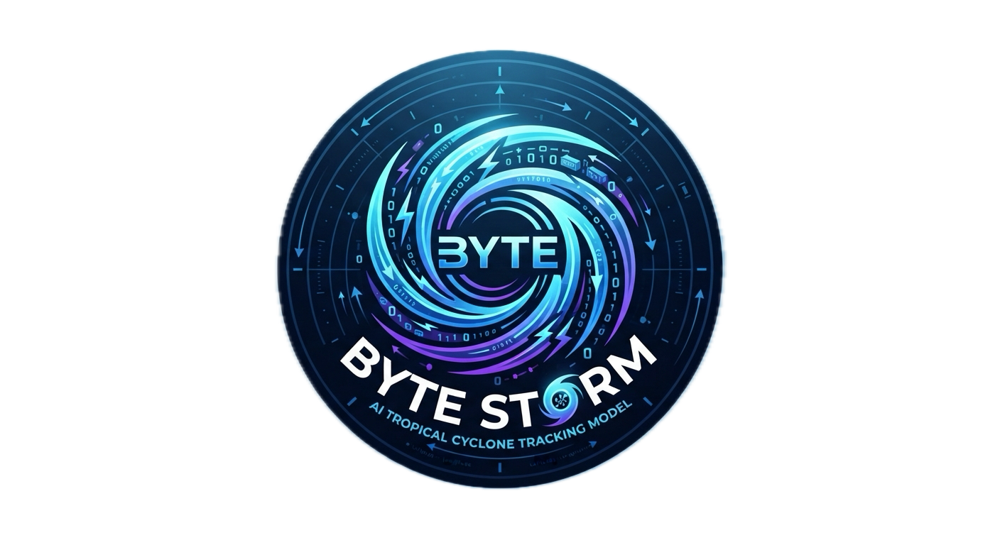
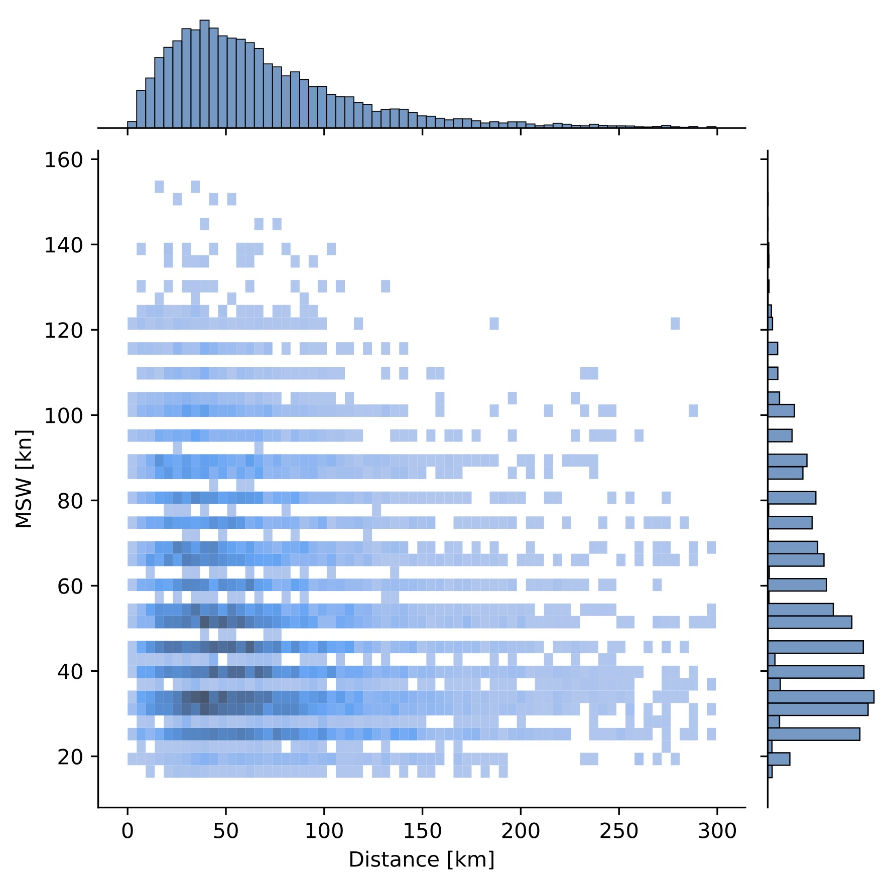
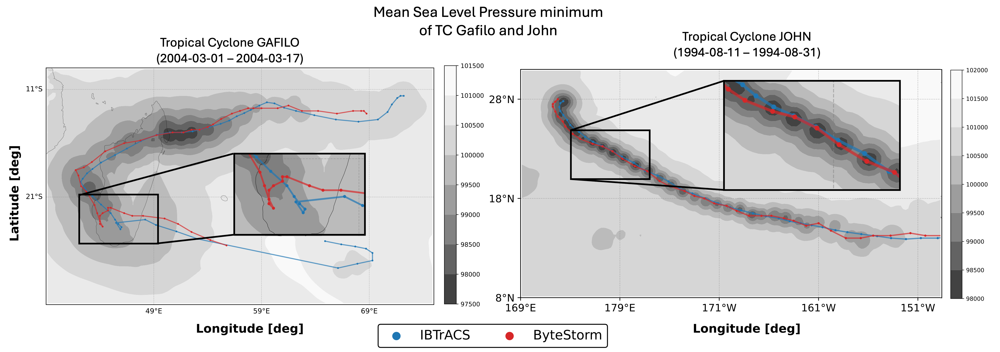
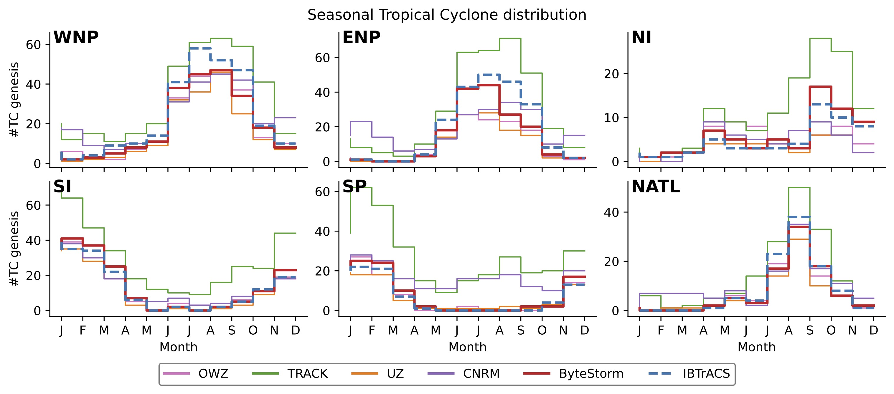
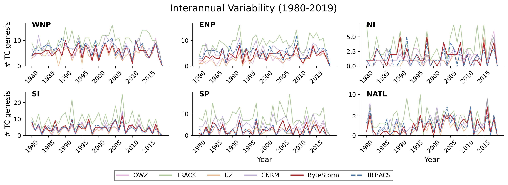
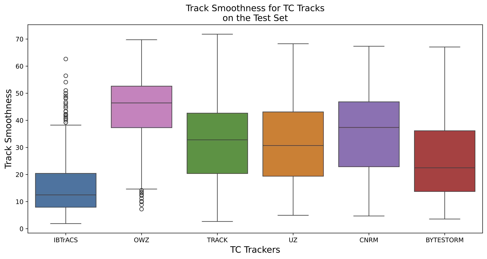
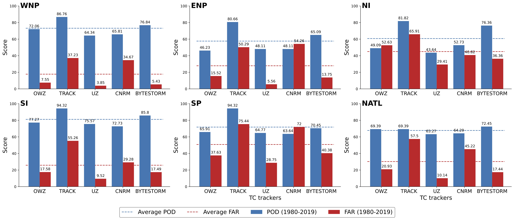
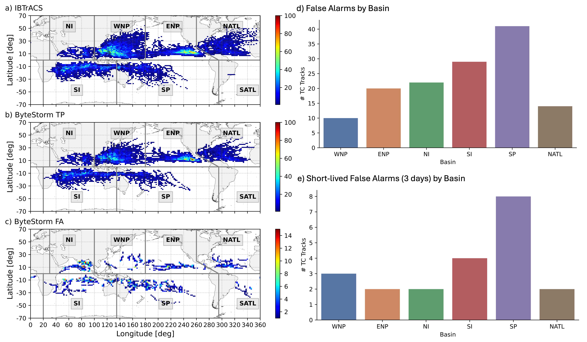

<p align="center">
    
</p>

# ByteStorm

**ByteStorm** is an innovative machine learning and computer vision approach designed specifically for the automated detection and tracking of tropical cyclones (TCs) using reanalysis data (such as ERA5). The DL model combines a binary classification stage, a localization stage, and a BYTE-based tracking module to produce continuous cyclone tracks from gridded weather data.

- **Two-phase architecture**:
    - **Detection and Localization**: Leverages two distinct deep learning models (one for classification and one for spatial localization) applied to patch-divided maps to identify the presence of the cyclone and accurately estimate the position of its center (the eye of the storm).
    - **Temporal Tracking**: Utilizes the BYTE multi-object tracking algorithm to connect the detected centers over time, reconstructing the storm's entire trajectory.

- **Key meteorological variables**: The model processes critical fields, i.e. *relative vorticity at 850 hPa* (RV850) and *mean sea level pressure* (MSLP).

- **High performance**: Performs comparably with traditional deterministic trackers by offering good balance between the *Probability of Detection* (POD) and the *False Alarm Rate* (FAR), demonstrating strong stability even under previously unseen climatic conditions and accurately reproducing interannual and seasonal variability (compared against the IBTrACS reference dataset).

- **Computational efficiency**: Represents a robust, scalable, and data-driven alternative to traditional purely dynamic forecasting and tracking models.

## Some Results

<table>
  <tr>
    <td width="25%">
      
    </td>
    <td width="74%">
      
    </td>
  </tr>
</table>
<table>
  <tr>
    <td width="44%">
      
    </td>
    <td width="53%">
      
    </td>
  </tr>
</table>

## Overview

The project is built around a multi-step pipeline:

- Data acquisition from ERA5-derived fields and IBTrACS metadata
- Patch extraction for tropical-cyclone and non-cyclone events
- Feature standardization using precomputed statistics
- Model training for cyclone classification and eye localization
- Inference over global or basin-based datasets
- Track association with the BYTE tracking algorithm

The implementation in `src/` and `resources/library/tropical_cyclone/` reflects this workflow, including training, inference, data preparation, and tracking utilities.

## Repository structure

```text
bytestorm/
├── LICENSE
├── README.md
├── requirements.txt
├── data/
│   ├── datasets/
│   │   ├── example_patches/
│   │   └── ...
│   └── ibtracs/
├── models/
│   ├── bytestorm_cls_NHS.toml
│   ├── bytestorm_cls_SHS.toml
│   ├── bytestorm_loc_NHS.toml
│   └── bytestorm_loc_SHS.toml
├── notebooks/
│   └── ...
├── resources/
│   └── library/
│       └── tropical_cyclone/
│           ├── __init__.py
│           ├── cyclone.py
│           ├── dataset.py
│           ├── models.py
│           ├── scaling.py
│           ├── callbacks.py
│           ├── diskio.py
│           ├── utils.py
│           ├── sampler.py
│           ├── era5.py
│           └── _cyclone/
│               ├── augmentation.py
│               ├── georef.py
│               ├── inference.py
│               ├── patch.py
│               ├── tracking.py
│               ├── utils.py
│               ├── visualize.py
│               └── tracker/
├── src/
│   ├── training.py
│   ├── inference.py
│   ├── dataset_download.py
│   ├── build_dataset_patches.py
│   ├── scaler.py
│   ├── info.py
│   ├── config/
│   │   ├── example.toml
│   │   ├── classification.toml
│   │   └── localization.toml
│   ├── dataset_download.sh
│   └── build_dataset_patches.sh
└── img/
```

## Methodology

ByteStorm follows a two-stage detection logic:

- Classification model: identifies whether a patch contains a tropical cyclone.
- Localization model: predicts the cyclone eye position when a cyclone is present.

The tracker then associates detections through time using the BYTE assignment logic from the library (`tropical_cyclone._cyclone.tracker`).

The principal input drivers used by the models are:

- `vo_850`: relative vorticity at 850 hPa
- `msl`: mean sea level pressure

These are used together with patch labels derived from IBTrACS-based cyclone locations and basin metadata.

## Requirements

The repository depends on a scientific Python stack and distributed training support. The main dependencies are declared in `requirements.txt` and include:

- Python 3.8+
- PyTorch / Lightning
- xarray, numpy, pandas, scikit-image
- mpi4py and OpenMPI for parallel data processing
- netCDF4, zarr, dask, cartopy

For MPI execution, OpenMPI or another compatible MPI runtime is required because the dataset-generation and training workflows rely on `mpirun`.

## Installation

```bash
git clone https://github.com/CMCC-Foundation/bytestorm.git
cd bytestorm

python -m venv .venv
source .venv/bin/activate
pip install -r requirements.txt
```

On macOS, OpenMPI may need to be installed separately if it is not already available:

```bash
brew install open-mpi
```

## Data preparation

The codebase expects a project structure similar to the one defined in `src/info.py` and the example configuration files. The main steps are:

### 1. Download atmospheric fields

The script `src/dataset_download.py` loads weather data from the WeatherBench2-era5 source and stores per-time-step NetCDF files in `data/datasets/global`.

```bash
mpirun -np 4 python src/dataset_download.py
```

### 2. Build patch datasets

`src/build_dataset_patches.py` converts global gridded fields into localized training and validation patches. It expects a basin code such as `EP` or `WP`.

```bash
mpirun -np 4 python src/build_dataset_patches.py EP
```

The dataset writer generates patch directories under a structure similar to:

```text
data/datasets/patches/{BASIN}/train
data/datasets/patches/{BASIN}/valid
```

### 3. Compute scaling statistics

The `src/scaler.py` script computes mean and standard deviation from the training patches and writes them to NetCDF files in `data/datasets/patches/`.

```bash
python src/scaler.py
```

This is consistent with the example configuration files, which reference files such as:

- `data/datasets/example_patches/mean_1980_2009.nc`
- `data/datasets/example_patches/std_1980_2009.nc`

## Training

The training entry point is `src/training.py`. It reads a TOML configuration file and starts a Lightning trainer.

The supported CLI arguments are:

- `-c` / `--config`: path to the configuration file
- `-n` / `--num_nodes`: number of nodes
- `-d` / `--devices`: number of devices per node

Example using the small sample configuration:

```bash
mpirun -np 1 python src/training.py -c src/config/example.toml -n 1 -d 1
```

A production-style configuration is available in:

- `src/config/classification.toml`
- `src/config/localization.toml`

The example configuration uses the sample zarr patches shipped in `data/datasets/example_patches/`, which allows a lightweight local test run without requiring a full training dataset.

## Model configuration examples

The TOML files define the model, loss, optimizer, and training hyperparameters. For example:

- classification: `classify = true`
- localization: `classify = false`
- drivers: `['vo_850', 'msl']`
- target: `['patch_cyclone']`

The repository includes a VGG-based architecture defined in `resources/library/tropical_cyclone/models.py` and selected by the `model.cls` field in the config files.

## Inference

The inference pipeline is implemented in `src/inference.py`. It expects the following positional arguments:

1. localization experiment name
2. classification experiment name
3. detection threshold
4. hemisphere (`NH` or `SH`)

```bash
python src/inference.py <EXPERIMENT_LOC> <EXPERIMENT_CLS> <THRESHOLD> <HEMISPHERE>
```

The script loads trained models, evaluates the test period, and writes per-year detection outputs to disk. This workflow is consistent with the global/local tracking pipeline implemented in `resources/library/tropical_cyclone/cyclone.py`.

## Tracking and evaluation

The library exposes tracking utilities and inference helpers under `resources/library/tropical_cyclone/`, including:

- `BYTETracker`
- detection prediction helpers
- track filtering and evaluation metrics
- visualization utilities for detections and tracks

This enables the full workflow:

- detect cyclone candidates
- localize the eye
- match detections over time
- compute POD/FAR and other track-level metrics

## Citation

If you use ByteStorm in your research, please cite the project accordingly.

## License

This project is licensed under the MIT License. See the [LICENSE](LICENSE) file for details.

## Funding and acknowledgement

This work received support from the interTwin project, funded by Horizon Europe under grant agreement No. 101058386.

The repository builds upon the tropical cyclone detection library available at:

- https://github.com/CMCC-Foundation/ml-tropical-cyclones-detection

The BYTE tracking implementation is adapted from the ByteTrack algorithm and the project also relies on ERA5 data and IBTrACS records for training and validation.

## References

- BYTE: Multi-Object Tracking by Associating Every Detection Box
- Intercomparison of four algorithms for detecting tropical cyclones using ERA5
- Copernicus Climate Change Service - ERA5
- International Best Track Archive for Climate Stewardship (IBTrACS)


## Results

<table>
  <tr>
    <td width="44%">
      
    </td>
    <td width="55%">
      
    </td>
  </tr>
</table>


